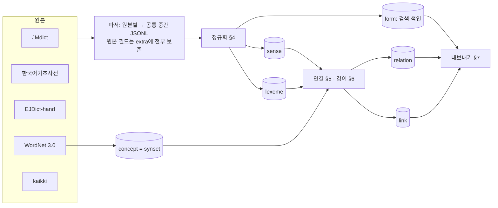

# anikan-ENJPKR-dictionary 계획서

한국어·일본어·영어를 서로 잇는 오픈 사전 데이터를 만든다. 원본은 공개 라이선스 사전 다섯 가지이고, 결과는 **뜻(sense) 단위로 세 언어를 연결한 데이터**(SQLite + JSONL)와 각 연결의 근거·신뢰도, 그리고 **표기·활용형·경어형 어느 것으로 찾아도 표제어에 닿는 검색 색인**이다.

- 작성: 2026-10-29 · 원본 다섯 가지는 모두 **받아서 전체를 세어 확인**(§2), 라이선스는 원문으로 확인(§9)
- 상태: 0~7단계 구현 완료(첫 빌드 2026-10-29, 수치는 `out/stats.md`), §12는 추천안으로 진행, gold 세트는 모델(Claude)이 라벨링한 것을 확정본으로 쓴다(§13)

## 1. 목표와 범위

| 언어쌍 | 지금 오픈 데이터의 사정 | 이 리포가 만드는 것 |
|---|---|---|
| 일본어 → 영어 | JMdict가 표준 | JMdict를 정규화해 포함 |
| 영어 → 일본어 | EJDict-hand(단어 단위), Wiktionary 번역표 | 둘을 합치고 WordNet 뜻 단위로 정리 |
| 한국어 ↔ 영어 | 한국어기초사전 대역어, Wiktionary | 둘을 합침 |
| **한국어 ↔ 일본어** | **큰 오픈 사전이 사실상 없음** | 한국어기초사전 일본어 대역어(뜻의 97.8 %에 있음) + Wiktionary 삼각 연결 + 한자 일치 + 영어 경유 |

목표 세 가지:
1. **연결**: 여러 근거를 모아 어느 근거로 연결했는지와 신뢰도를 함께 낸다.
2. **정규화**: 원본에 있는 정보(표기 변형, 읽기·발음, 품사·활용 부류, 문체·경어, 분야·지역, 빈도·난이도, 예문, 어원)를 버리지 않고 공통 체계로 옮긴다(§4).
3. **검색**: 한국어·일본어는 **존댓말·경어나 활용형으로 찾아도** 기본형 표제어가 나온다. 「드세요」 → 들다(높임) → 먹다, 「召し上がります」 → 召し上がる(尊敬) → 食べる(§6).

**하지 않는 것**: 새 뜻풀이를 사람이 쓰는 일(경어 핵심 어휘 대응표 §6.3만 예외), 예문 말뭉치 추가(Tatoeba는 확장 후보), 음성 파일.

## 2. 원본 다섯 가지 — 받아서 전체를 센 결과 (2026-10-29)

| 원본 | 판·크기 | 형식·구조 | 전체 수치 | 라이선스 | 받는 법 |
|---|---|---|---|---|---|
| [JMdict](https://www.edrdg.org/jmdict/j_jmdict.html) (EDRDG) | 2026-10-29판, gz 22 MB | XML+DTD. `entry/ent_seq` → `k_ele/keb`(한자 표기, `ke_pri`) · `r_ele/reb`(읽기, `re_pri`) · `sense`(`pos`·`xref`·`ant`·`field`·`misc`·`dial`·`gloss xml:lang`·`example`) | 표제어 218,975 · 한자 표기 233,706 · 읽기 265,916 · 뜻 678,609. gloss: 영 443,937 · 독 336,989 · 네 273,205 · 헝 158,811 · 러 105,087 · 스 68,288 · 프 33,782 · 슬로 21,673 · 스웨 17,389, **한국어 없음**. 영어 외 언어는 영어 sense와 따로 붙음. 반의어 `ant` 1,122 · 참조 `xref` 37,027. 빈도 태그 nf 44,959 · news 44,922 · ichi 18,576 · spec 6,904 · gai 4,284. 경어 `misc`: 존경 `hon` 748 · 겸양 `hum` 289 · 정중 `pol` 442 뜻(기본형으로 가는 `xref`는 각 200 · 55 · 222개에만) | CC BY-SA 4.0 + EDRDG 추가 조건(§9) | `https://www.edrdg.org/pub/Nihongo/JMdict.gz` |
| 한국어기초사전 (국립국어원) | 2026-10-19판, zip 84 MB(JSON 11개, 풀면 1 GB) | LMF JSON. §2.1 | §2.1 | CC BY-SA 2.0 KR | **로그인 없이** 받음: 내려받기 창 `/download/downloadPopup`의 JSON 버튼 → `/dicBatchDownload?seq=220`(seq는 판마다 바뀌므로 창에서 읽음) |
| [EJDict-hand](https://github.com/kujirahand/EJDict) | 커밋 `2dd9e71`(2026-10-27) | TSV `src/a.txt`…: `표제어(쉼표로 이표기) ⇥ 뜻(" / "로 구분)`. 품사·ID 없음. `frequency/`는 빈도 수치가 아니라 기본 어휘 목록 3개(100 · 850 · 2000단어) | 45,366줄 · 표제어 47,028(이표기 포함). 뜻 안 표시: `『』` 29,163 · 가산 〈C〉 5,795 · 불가산 〈U〉 4,666 · 《話》 1,271 · 《米》 884 · 《英》 839 · 《文》 470 · 《俗》 239 · 《古》 193 … | **CC0** | git |
| [Princeton WordNet 3.0](https://wordnet.princeton.edu/) | WNdb-3.0(10 MB) + 라이선스는 WordNet-3.0.tar.gz | `data.{noun,verb,adj,adv}` 한 줄 = synset(`오프셋 · 품사 · 단어들 · 포인터 \| 풀이`), `index.*` = 표제어 → synset(빈도순), `index.sense` = sense key → 태그 빈도 | synset 117,659 · sense 206,941(태그 빈도가 있는 것 35,478, 합계 249,492) · 반의어 포인터 `!` 7,979(형용사 4,024 · 명사 2,152 · 동사 1,093 · 부사 710) | WordNet License(§9) | `https://wordnetcode.princeton.edu/3.0/WNdb-3.0.tar.gz` |
| [kaikki.org](https://kaikki.org) (wiktextract, 영어 Wiktionary) | 2026-10-25판 | JSONL. `word`·`pos`·`forms[]`(태그 붙은 표기·**활용형**)·`senses[]`(`glosses`·`tags`·`synonyms`·`antonyms`·`examples`·`translations`)·`sounds`·`etymology_text` | **일본어** 388 MB: 표제어 200,030(그중 soft-redirect 45,031 · 로마자 항목 32,126) · 뜻 237,987 · 반의어 4,117 · 유의어 33,748 · 구자체 표기 27,312 · **활용형**(부정 143,467 · 정중 `formal` 80,933 · `polite` 2,108 …) · 경어 뜻 태그 존경 284 · 겸양 155 · 정중 129. **한국어** 208 MB: 표제어 64,457 · 뜻 82,555 · 반의어 1,401 · 유의어 14,507 · 한자 표기 18,868 · **활용형**(정중 `polite` 159,470 · 격식 `formal` 217,152 · 문법적 높임 `honorific`은 16뿐) · 경어 뜻 태그 존경 89 · 겸양 32. **영어** 3.4 GB: 표제어 1,499,161 중 일·한 번역이 있는 것 43,393(일본어 번역 70,575 · 한국어 44,280 · 둘 다 24,234). 번역은 대부분 뜻(`senses[].translations`) 아래 | Wiktionary: CC BY-SA 4.0 + GFDL(§9) | 언어별 JSONL. 영어는 받으면서 일·한 번역만 거름 → **40.8 MB**(이 기기에서 13분) |

### 2.1 한국어기초사전 전체 분석

| 항목 | 값 |
|---|---|
| 표제어 | 56,555 — 단어 51,555 · 관용구 2,227 · 구 1,120 · 문법·표현 996 · 속담 657 |
| 구조 | `LexicalResource.Lexicon.LexicalEntry[]` → `feat`(`lexicalUnit`, `homonym_number`, `partOfSpeech`, `vocabularyLevel` 초·중·고급, `semanticCategory` 44,506, `subjectCategiory`(원문 철자) 6,297, **`origin` 원어** 36,151 — 그중 한자 34,147, `annotation`) · `Lemma`(대표 표기·이표기) · `WordForm`(**발음 50,954 · 활용 35,586**, 예: 가다 → 가는·가·가니·갑니다) · `RelatedForm`(파생어 13,166 · ☞ 9,889) · `Sense[]` |
| 뜻(Sense) | 76,833. `definition` · `syntacticPattern` 25,524 · `SenseExample` · `Multimedia` · `Equivalent[]` · `SenseRelation[]` |
| 대역어 | 11개 언어, **일본어가 있는 뜻 75,144 · 영어 75,145(97.8 %)**. 대역어마다 그 언어 뜻풀이도 있음. 일본어 형식 `かかくひょう【価格表】` = **읽기【한자】** |
| 뜻 관계 | 유의어 14,374 · 참고어 10,445 · **반대말 2,802** · 작은말 1,286 · 큰말 1,211 · 여린말 695 · 준말 669 · 본말 639 · 센말 560 · **높임말 93 · 낮춤말 17** (대상 `id`·`lemma`·`homonymNumber`) |
| 경어 표시 뜻풀이 | 「(높이는 말로)」 100 · 「(높임말로)」 80 · 「(낮추는 말로)」 18 · 「(조금 높이는 말로)」 7 · 「(낮춤말로)」 6 = 211. 그중 **37개는 뜻풀이가 기본형 한 단어**(들다 → 「(높임말로) 먹다.」, 모시다 → 데리다, 병환 → 병, 말씀하다 → 말하다 …) |
| 경어끼리의 한일 대응 | 경어 표제어의 일본어 대역어도 경어: 잡수시다 → 召し上がる, 계시다 → いらっしゃる, 드리다 → 差し上げる, 여쭈다 → 伺う, 뵙다 → お目にかかる |

## 3. 통합 데이터 모델

원본마다 단위가 다르다(JMdict = 표제어+뜻, EJDict = 단어 줄, WordNet = 개념, kaikki = 품사별 표제어). 그래서 **표제어(lexeme) – 뜻(sense) – 연결(link)** 세 층으로 모으고, 영어 쪽 개념은 **WordNet synset**을 축으로 쓴다. 검색은 별도 색인(`form`)이 맡는다.



### 3.1 테이블 (SQLite 기준)

```sql
-- 표제어: 언어별 한 형태
CREATE TABLE lexeme (
  id          TEXT PRIMARY KEY,   -- 'ja:jmdict:1206730', 'ko:krdict:12345', 'en:wn:dog' …
  lang        TEXT NOT NULL,      -- 'en' | 'ja' | 'ko'
  lemma       TEXT NOT NULL,      -- 대표 표기(NFC)
  reading     TEXT,               -- 일본어 가나 읽기 / 한국어 표준 발음(기초사전 WordForm 발음)
  hanzi       TEXT,               -- 한자 표기: 일본어 keb / 한국어 원어·kaikki hanja
  hanzi_norm  TEXT,               -- 신자체·구자체·번체를 맞춘 비교용 열쇠(§4.1)
  pos         TEXT,               -- 공통 품사(§4.2)
  infl_class  TEXT,               -- 활용 부류: 'v5k','v1','adj-i','vs' / 'ko-regular','ko-irr-b','ko-irr-d' …(§4.2)
  register    TEXT,               -- 문체·경어(§4.3): 'plain' | 'honorific' | 'humble' | 'polite' | 'beautified' | 'informal' | 'literary' …
  level       TEXT,               -- 난이도·빈도 공통 등급(§4.5)
  source      TEXT NOT NULL,
  source_id   TEXT NOT NULL,
  extra       TEXT                -- JSON: 원본 필드 전부(버리지 않음)
);

-- 뜻: 표제어의 뜻 하나
CREATE TABLE sense (
  id          TEXT PRIMARY KEY,   -- lexeme id + '#' + 순번
  lexeme_id   TEXT NOT NULL REFERENCES lexeme(id),
  ord         INTEGER,
  definition  TEXT,               -- 같은 언어 뜻풀이(기초사전 한국어 뜻, WordNet 풀이)
  def_lang    TEXT,
  glosses     TEXT,               -- JSON {"en": [...], "ja": [...]} 원본이 준 대역어·풀이
  register    TEXT,               -- 뜻 단위 문체·경어(같은 단어라도 뜻마다 다를 수 있음)
  labels      TEXT,               -- JSON: 분야·지역·용법 공통 라벨(§4.4)
  examples    TEXT,               -- JSON [{text, translation, lang, source}]
  extra       TEXT
);

-- 개념: 영어 축(WordNet synset)
CREATE TABLE concept (
  id TEXT PRIMARY KEY,            -- 'wn30:02084071-n'
  pos TEXT, lemmas TEXT, gloss TEXT, lexfile TEXT   -- lexfile = noun.food 같은 분류
);

-- 다른 언어로의 연결(대역어): 근거마다 한 줄
CREATE TABLE link (
  src TEXT NOT NULL, dst TEXT NOT NULL,
  kind TEXT NOT NULL,             -- 'translation' | 'concept'
  method TEXT NOT NULL,           -- §5
  confidence REAL NOT NULL,
  evidence TEXT,
  sources TEXT NOT NULL           -- JSON: 쓰인 원본(크레딧 계산용)
);

-- 같은 언어 안의 관계: 반의어·유의어·경어 대응 등(§5.1, §6)
CREATE TABLE relation (
  src TEXT NOT NULL, dst TEXT NOT NULL,
  type TEXT NOT NULL,             -- 'antonym' | 'synonym' | 'see_also' | 'derived' | 'abbrev_of' |
                                  -- 'honorific_of' | 'humble_of' | 'polite_of' | 'plain_of_honorific' …
  method TEXT NOT NULL,           -- 'source' | 'definition' | 'projected' | 'curated'
  confidence REAL NOT NULL,
  sources TEXT NOT NULL
);

-- 검색 색인: 어떤 꼴로 찾아도 표제어에 닿게(§6)
CREATE TABLE form (
  key         TEXT NOT NULL,      -- 검색 열쇠(§4.1 검색 정규화를 거친 꼴)
  surface     TEXT NOT NULL,      -- 실제 꼴: 召し上がります, 드세요, 가십니다, 學校, gakkō …
  lang        TEXT NOT NULL,
  lexeme_id   TEXT NOT NULL,
  kind        TEXT NOT NULL,      -- 'lemma' | 'variant' | 'reading' | 'romaji' | 'hanzi' |
                                  -- 'inflection' | 'honorific_inflection' | 'lexical_honorific'
  features    TEXT,               -- JSON: {"politeness":"polite","honorific":true,"tense":"past","polarity":"neg"}
  via         TEXT,               -- lexical_honorific면 경어 표제어 id(召し上がる → 食べる의 색인 줄)
  source      TEXT NOT NULL       -- 'kaikki' | 'krdict' | 'rule:ko-si' | 'rule:ja-masu' …
);
CREATE INDEX form_key ON form(key, lang);
```

### 3.2 원본 → 모델 대응

| 원본 | lexeme | sense | 바로 나오는 link·relation·form |
|---|---|---|---|
| JMdict | `entry` 하나(keb·reb 조합은 `form`의 variant/reading) | `sense` (영어 gloss 기준, 다른 언어 sense는 `extra`) | 일 → 영 gloss, `ant`·`xref` 관계, `misc` 경어·문체 |
| 한국어기초사전 | `LexicalEntry` | `Sense` | 한 → 일·영 대역어, `SenseRelation`·`RelatedForm` 관계, `WordForm` 발음·활용 → `form` |
| EJDict-hand | 줄의 표제어(이표기 각각) | 줄 하나 = 뜻 하나 | 영 → 일 대역어, 《話》《米》 등 → 라벨 |
| WordNet | `index.*` 표제어 | synset 소속 하나 | 영 sense → concept, `!` 반의어, 같은 synset 유의어 |
| kaikki | `word`+`pos`(+`etymology_number`) | `senses[]` | 일·한 → 영 gloss, 영 번역표 → 일·한, `forms` 활용형 → `form`, `tags` 경어·문체 |

## 4. 정규화 — 원본 정보를 버리지 않고 공통 체계로

원칙: **원본 필드는 `extra`에 그대로 두고**, 공통 체계로 옮길 수 있는 것은 전부 옮긴다. 대응표는 `mappings/*.tsv`로 리포에 두어 사람이 고칠 수 있게 한다.

### 4.1 문자·표기
| 대상 | 저장 | 검색 열쇠(`form.key`) |
|---|---|---|
| 공통 | NFC, 제어문자 제거 | NFKC + 소문자 + 공백·`・`·`-`·`^` 제거 |
| 일본어 가나 | 원래 꼴 | 가타카나 → 히라가나, 장음 `ー`는 그대로 둔 것·모음으로 푼 것 둘 다 |
| 일본어 한자 | 원래 꼴 | 구자체 → 신자체(kaikki `kyūjitai` 표기 27,312 + Unihan 이체자 + 상용한자 구자체표) |
| 한국어 | 원래 꼴(기초사전 `^`·`-` 제거) | 띄어쓰기 제거한 꼴도 추가(「가격 표」 → 가격표) |
| 한국어 한자어 | `hanzi` = 원어 | 번체·신자체를 하나의 `hanzi_norm`으로 → 일본어 한자 표기와 같은 열쇠 |
| 로마자 | — | 일본어 헵번식(kaikki romanization + 규칙), 한국어 국어의 로마자 표기법(규칙) → `kind='romaji'` |
| 자리표시 | 「대응 어휘 없음」「no equivalent」「対訳語無し」 등은 버림 | — |

### 4.2 품사·활용 부류
- 공통 품사: `noun`, `verb`, `adj`, `adj-na`(형용동사), `adv`, `pron`, `num`, `det`(관형사·連体詞), `particle`, `aux`, `copula`, `interj`, `conj`, `affix`, `suffix`, `prefix`, `phrase`, `idiom`, `proverb`, `grammar`(기초사전 문법·표현), `name`. 원본 품사는 `extra`에.
- 대응표 `mappings/pos.tsv`: JMdict 엔티티(`n`, `v1`, `v5k`, `vs`, `adj-i`, `adj-na`, `adj-no`, `exp`, `prt` …), 기초사전(`명사`, `동사`, `형용사`, `관형사`, `조사`, `어미`, `접사`, `의존 명사` …, lexicalUnit 관용구·속담·문법·표현), kaikki(`noun`, `verb`, `adj`, `soft-redirect`(→ 표제어 아님, 표기 변형으로) …), WordNet(`n`, `v`, `a`, `s`, `r`), EJDict(없음 → 다른 원본 영어 품사로 추정, 확신 없으면 비움).
- 활용 부류(`infl_class`): 일본어는 JMdict 동사·형용사 엔티티 그대로(`v5k`, `v1`, `vs-i`, `vk`, `adj-i` …). 한국어는 규칙·불규칙 분류(`ko-regular`, ㅂ·ㄷ·ㅅ·르·러·우·여·ㅎ 불규칙, ㄹ 탈락)를 kaikki 활용표와 기초사전 활용 예(`WordForm`)에서 뽑아 정한다(§6.2 생성기의 입력).

### 4.3 문체·경어(`register`)
| 공통 값 | JMdict `misc` | 한국어기초사전 | kaikki `tags` | EJDict |
|---|---|---|---|---|
| `honorific`(존경·높임) | `hon` | 「(높임말로)」「(높이는 말로)」「(조금 높이는 말로)」, 관계 「높임말」의 대상 | `honorific`, `respectful` | — |
| `humble`(겸양·낮춤) | `hum` | 「(낮추는 말로)」「(낮춤말로)」, 관계 「낮춤말」 | `humble`, `deferential` | — |
| `polite`(정중) | `pol` | — | `polite` | — |
| `beautified`(美化語 お·ご) | `pol` 중 お·ご 접두 | — | — | — |
| `informal`·`colloquial` | `col` | — | `informal`, `colloquial`, `familiar` | 《話》 |
| `literary`·`archaic`·`dated` | `arch`, `obs`, `poet` | — | `literary`, `archaic`, `dated` | 《文》《古》 |
| `slang`·`vulgar`·`derogatory` | `sl`, `vulg`, `derog` | 「(낮추는 말로)」 중 비하 | `slang`, `vulgar`, `derogatory` | 《俗》 |

### 4.4 분야·지역·용법 라벨(`labels`)
- 분야: JMdict `field`(`comp`, `med`, `law` …), 기초사전 `semanticCategory`·`subjectCategiory`, WordNet lexfile(`noun.food` …), kaikki `topics`·`categories`(일부) → `mappings/domain.tsv`로 공통 분야.
- 지역·방언: JMdict `dial`(`ksb` 관서 …), EJDict 《米》《英》, kaikki 지역 태그 → `region:US`, `region:Kansai` …
- 용법: EJDict 가산 〈C〉·불가산 〈U〉 → `countable`, 《複数形で》 → `plural-only`; JMdict `misc`의 `uk`(가나로 씀), `abbr`, `on-mim`(의성·의태) …

### 4.5 빈도·난이도(`level`)
| 원본 | 정보 | 공통화 |
|---|---|---|
| JMdict | `ichi1/2`, `news1/2`, `spec1/2`, `gai1/2`, `nf01–48` | `nf` 순위로 1–48 구간, 태그 있으면 「상용」 |
| 한국어기초사전 | 초급·중급·고급 | 그대로 + 숫자 1–3 |
| EJDict | 기본 어휘 100 · 850 · 2000 목록 | 목록 소속 |
| WordNet | `index.sense` 태그 빈도(35,478개 뜻에 있음) | 뜻 순위·빈도 그대로 |
값은 원본별로 따로 저장하고, 정렬용으로만 합친 점수를 둔다(서로 다른 척도를 억지로 하나로 만들지 않음).

### 4.6 그 밖
- 발음: 기초사전 `WordForm` 발음(50,954, 장음 표기 포함), kaikki `sounds`(IPA·음성 파일 주소는 주소만).
- 예문: 기초사전 `SenseExample`, JMdict `example`(Tatoeba 출처 표시가 붙은 것), kaikki `examples` → `sense.examples`에 출처와 함께.
- 어원: 기초사전 `origin`, kaikki `etymology_text`.
- 문형: 기초사전 `syntacticPattern`(25,524, 「1이 2를 3에게 주다」 같은 꼴) → `extra`와 검색 비대상 보존.

## 5. 연결 방법과 신뢰도

같은 쌍에 근거가 여러 개면 noisy-OR로 합친다.

| # | method | 무엇을 잇나 | 근거 | 기본 신뢰도 |
|---|---|---|---|---|
| 1 | `krdict_equivalent` | 한 sense → 일·영 | 국립국어원이 뜻마다 단 대역어(일본어는 `읽기【한자】`를 갈라 JMdict 표제어로) | 0.9 |
| 1 | `jmdict_gloss` | 일 sense → 영 | JMdict gloss | 0.9 |
| 1 | `ejdict` | 영 → 일 | EJDict 줄(단어 단위라 뜻 구분 없음) | 0.8 |
| 2 | `kaikki_translation` | 영 sense → 일·한 | Wiktionary 번역표(뜻 설명 포함) | 0.8 |
| 2 | `kaikki_triangle` | 일 ↔ 한 | **같은 영어 번역표 뜻**에 함께 달린 일·한 단어(24,234개 영어 표제어) | 0.75 |
| 3 | `hanzi_match` | 일 ↔ 한 | `hanzi_norm` 일치 **그리고** 영어 풀이 겹침 | 0.85 / 영어가 안 겹치면 0.4(거짓 친구 의심) |
| 4 | `en_pivot` | 일 sense ↔ 한 sense | 양쪽 영어 대역어가 같은 WordNet synset(IDF 가중) | 0.3–0.7 |
| 5 | `wn_concept` | 각 언어 sense → concept | 영어 대역어의 WordNet 표제어 + 품사 + 풀이 유사도 | 0.3–0.9 |
| 6 | `register_align` | 일 경어 ↔ 한 경어 | 위 연결 중 양쪽 `register`가 같은 것에 가산(잡수시다 ↔ 召し上がる) | +0.05 |

- 거짓 친구: 같은 한자어라도 뜻이 다른 말(勉強 = 일 「공부」, 한 「면강 = 억지로 시킴」)은 영어 겹침 검사로 걸러 낮은 신뢰도로.
- 영어 다의어(bank, run)는 WordNet 빈도순·품사·풀이 겹침으로 점수. 0.5 미만은 기본 내보내기에서 뺀다.
- 일본어 표기 해소: 기초사전·kaikki의 일본어 대역어를 JMdict keb·reb로 찾아 표제어 ID에. 못 찾으면 `ja:unlinked:`.

### 5.1 반의어·유의어 등

| 원본 | 반의어 | 유의어·기타 | 전체 수 |
|---|---|---|---|
| JMdict | `ant`(「단어・뜻번호」 꼴) | `xref` | 반의어 1,122 · 참조 37,027 |
| 한국어기초사전 | 「반대말」 | 유의어·참고어·작은말/큰말·준말/본말·여린말/센말·높임말/낮춤말, 파생어 | 반대말 2,802 · 유의어 14,374 · 참고어 10,445 … |
| WordNet 3.0 | `!` | 같은 synset, `&` · `@` … | 반의어 7,979 |
| kaikki | `antonyms` | `synonyms`·`related`·`derived` | 일본어 반의어 4,117 · 유의어 33,748 / 한국어 반의어 1,401 · 유의어 14,507 |
| EJDict-hand | 없음 | 없음 | — |

- 원본 관계(`method='source'`, 0.9): 대상 문자열을 같은 원본의 표제어·뜻 ID로 푼다.
- 다른 언어로 옮기기(`'projected'`): A ↔ B 반의어이고 A′·B′가 각각 A·B의 대역(0.7 이상)이면 A′ ↔ B′ 후보. 신뢰도 = 반의어 × 두 대역 신뢰도. 예: `hot ! cold` + 暑い↔hot · 寒い↔cold → 暑い ↔ 寒い.

## 6. 존댓말·경어 검색

목표: 한국어·일본어에서 **경어 표제어**, **경어·정중 활용형**, **일반 활용형** 어느 것으로 찾아도 기본형 표제어와 그 대역어가 나온다. 반대로 기본형에서 경어 대응(먹다 → 드시다·잡수시다, 食べる → 召し上がる·いただく)도 보여 준다.

```mermaid
flowchart LR
  Q[검색어\n드세요 / 召し上がりました] --> K[검색 정규화 §4.1]
  K --> F{form 색인}
  F -->|inflection / honorific_inflection| H[경어 표제어\n들다(높임) · 召し上がる]
  F -->|lemma| B
  H -->|relation honorific_of| B[기본형\n먹다 · 食べる]
  B --> T[대역어\n食べる ↔ 먹다 ↔ eat]
```

### 6.1 어휘적 경어(다른 단어로 바뀌는 경어) → `relation`
| 근거 | 무엇 | 양 | method · 신뢰도 |
|---|---|---|---|
| 기초사전 관계 「높임말」「낮춤말」 | 나이 → 연세, 데리다 → 모시다, 누나 → 누님 | 110 | `source` 0.95 |
| 기초사전 뜻풀이 「(높임말로) X.」 | X가 표제어 하나면 그 단어로(들다 → 먹다, 돌아가다 → 죽다, 병환 → 병) | 37 | `definition` 0.9 |
| 같은 뜻풀이에서 X가 풀어쓴 설명 | 「(높임말로) 생명을 잃다.」 → 영어·일본어 대역어가 같은 기본형 후보에 연결 | 174 | `definition` + 대역 일치 0.6–0.8 |
| JMdict `misc` hon·hum·pol + `xref` | お鍋 → 鍋 | xref 있는 477 | `source` 0.9 |
| JMdict 경어 뜻의 영어 gloss | 「to eat (hon)」 → 같은 gloss의 일반 표제어(食べる) | 경어 뜻 1,479 중 나머지 | `definition` 0.6–0.8 |
| kaikki 경어 뜻 풀이 | 「honorific equivalent of 食べる」 같은 문장 패턴 | 일 568 · 한 121 | `definition` 0.85 |
| **핵심 경어 대응표(사람이 정리)** | 아래 | 한 · 일 각 30–50개 | `curated` 1.0 |

핵심 경어 대응표 `mappings/honorific_core.tsv`(이 리포가 작성, 결과와 같은 라이선스):
- 한국어: 먹다 → 드시다·잡수시다 / 자다 → 주무시다 / 있다 → 계시다 / 주다 → 드리다 / 묻다 → 여쭈다·여쭙다 / 보다(만나다) → 뵙다 / 말하다 → 말씀하시다·말씀드리다 / 죽다 → 돌아가시다 / 아프다 → 편찮으시다 / 데리다 → 모시다 / 말 → 말씀 / 집 → 댁 / 이름 → 성함 / 나이 → 연세 / 밥 → 진지 / 병 → 병환 / 생일 → 생신 / 나 → 저 / 우리 → 저희 …
- 일본어(尊敬 / 謙譲): 食べる·飲む → 召し上がる / いただく · 行く·来る·いる → いらっしゃる·おいでになる / 参る·伺う·おる · 言う → おっしゃる / 申す·申し上げる · 見る → ご覧になる / 拝見する · する → なさる / いたす · くれる → くださる · もらう → いただく · あげる → 差し上げる · 知る → ご存じだ / 存じる · 会う → お会いになる / お目にかかる · 聞く → お聞きになる / 伺う·承る · 思う → お思いになる / 存じる · 寝る → お休みになる · 着る → お召しになる …
- 표의 각 줄은 JMdict `hon`·`hum` 표시와 기초사전 대역어로 교차 검증하고, 맞지 않는 줄은 리뷰한다.

### 6.2 문법적 경어·활용형 → `form`
| 언어 | 무엇 | 출처 | 비고 |
|---|---|---|---|
| 일본어 | 정중형(ます·です), 부정·과거·て형·가능·수동·사역 … | **kaikki 활용표**(정중 `formal` 80,933 · `polite` 2,108 · 부정 143,467 …) | 활용표가 없는 동사·형용사는 규칙 생성 |
| 일본어 | 尊敬 「お〜になる」「ご〜になる」「〜(ら)れる」, 謙譲 「お〜する」「ご〜する」「お〜いたす」 | 규칙 `rule:ja-keigo` (JMdict 활용 부류 `v5*`·`v1`·`vs` 기준) | 경어 동사(召し上がる 등)의 정중형도 함께 |
| 한국어 | 해요체(-아요/어요), 하십시오체(-ㅂ니다/습니다), 해체 … | **kaikki 활용표**(정중 159,470 · 격식 217,152) + **기초사전 활용 예**(35,586) | |
| 한국어 | **높임 '-(으)시-'** + 해요·하십시오체(가시다·가세요·가십니다·가셨어요 …) | 규칙 `rule:ko-si` — kaikki에 높임 활용이 16개뿐이라 생성 | 불규칙 부류(§4.2)는 kaikki·기초사전 활용 예로 검증 |
| 한국어 | 높임 조사·명사 접미(께서·께·-님) | 핵심 대응표 | 가 → 께서, 에게 → 께 |

- 규칙 생성기는 자체 코드다(다른 프로젝트의 활용 규칙을 복사하지 않음). 생성한 꼴이 kaikki 활용표·기초사전 활용 예와 겹치는 단어로 정확도를 잰다(§10).
- 각 `form` 줄에 `features`(정중·높임·시제·부정)를 달아, 검색 결과에 「드세요 = 들다 + 높임 + 해요체 → 먹다의 높임」처럼 풀어 보여 줄 수 있게 한다.

### 6.3 검색 동작(결과물에 넣는 참조 구현)
1. 검색어 → §4.1 검색 열쇠.
2. `form`에서 찾기: 표제어 > 표기 변형·읽기 > 활용형 > 경어 활용형 순.
3. 찾은 표제어가 경어면 `relation honorific_of / humble_of`를 따라 기본형도 함께 낸다.
4. 기본형의 `link`로 다른 두 언어 대역어.
- 참조 구현: 파이썬 `anikan.search` + SQLite 질의 예시. 앱은 SQLite만 있으면 같은 순서로 찾을 수 있다.

## 7. 결과물

| 결과물 | 내용 |
|---|---|
| `anikan.sqlite` | §3.1 전체(lexeme · sense · concept · link · relation · form) |
| `pairs/{ja-ko,ko-ja,en-ja,ja-en,en-ko,ko-en}.jsonl` | 표제어 + 뜻 + 대역어 + 반의어·유의어 + 경어 대응 + 신뢰도·근거·원본 |
| `pairs/*.tsv` | 신뢰도 0.7 이상, 한 줄 = 표제어 ⇥ 읽기 ⇥ 대역어 |
| `forms/{ja,ko}.tsv` | 검색 꼴 ⇥ 표제어 ⇥ 종류 ⇥ 자질(활용·경어 색인만 따로) |
| `stats.md` | 원본별 개수, 방법별 연결 수, 덮는 비율, 활용 생성 정확도 |
| `ATTRIBUTION.md` + `LICENSES/` | 원본별 저작권·라이선스 원문 |

결과 데이터는 git에 넣지 않고 **GitHub Releases**에 날짜 버전(`2026.11.0`)으로. 리포에는 코드·대응표·작은 표본만.

## 8. 리포 구성

```
anikan-ENJPKR-dictionary/
├─ PLAN.md · README.md · ATTRIBUTION.md · LICENSE(MIT, 코드) · LICENSES/(원본 라이선스 원문, 데이터는 CC-BY-SA-4.0)
├─ sources.toml          # 원본 버전·주소·체크섬 고정
├─ raw/                  # 받은 원본(.gitignore)
├─ anikan/
│  ├─ fetch/             # 원본별 받기(기초사전 seq 읽기, 영어 kaikki 스트림 필터)
│  ├─ parse/             # 원본별 → 공통 중간 JSONL(extra 보존)
│  ├─ normalize/         # 문자·표기·품사·활용 부류·문체·라벨·등급(§4)
│  ├─ inflect/           # 활용·경어 생성기 ja·ko(§6.2)
│  ├─ link/              # 연결 §5, 관계 §5.1, 경어 §6.1
│  ├─ search/            # 참조 검색 구현(§6.3)
│  └─ export/            # SQLite · JSONL · TSV · stats
├─ mappings/             # pos.tsv, register.tsv, domain.tsv, kyujitai.tsv, honorific_core.tsv, placeholders.tsv
├─ qa/                   # gold 세트, 평가 스크립트
└─ tests/                # 원본별 작은 표본, 활용·경어 회귀 테스트
```

도구: Python 3.12, `lxml`(JMdict 스트림), `orjson`, SQLite, `pytest`.

## 9. 라이선스 (원문 확인)

| 원본 | 라이선스 | 조건(원문에서) |
|---|---|---|
| JMdict | CC BY-SA 4.0 + [EDRDG 라이선스](https://www.edrdg.org/edrdg/licence.html) | 출처 표시. 사전 화면을 제공하면 **화면마다(또는 About·Sources 화면에) 출처 표시, 시작 화면만은 부족**. 소프트웨어에는 문서·라이선스 파일 사본 동봉. JMdict 자료에 **저작권 주장 금지** |
| 한국어기초사전 | CC BY-SA 2.0 KR ([저작권 정책](https://krdict.korean.go.kr/kor/kboardPolicy/copyRightTermsInfo)) | 상업적 이용 포함 자유. 저작자 표시, 변경한 자료는 동일조건 |
| kaikki / Wiktionary | Wiktionary 본문: CC BY-SA 4.0 + GFDL | 출처 표시, 동일조건. kaikki는 학술 사용 시 Wiktextract 논문(Ylonen, LREC 2022) 인용을 요청 |
| EJDict-hand | CC0 1.0 | 의무 없음(크레딧에는 적음) |
| WordNet 3.0 | WordNet License(`WordNet-3.0.tar.gz`의 LICENSE) | 모든 사본·수정본에 저작권 고지(「WordNet 3.0 Copyright 2006 by Princeton University」)와 면책 문구 포함. **Princeton 이름을 광고·홍보에 쓰지 않음** |

- **결과 데이터: CC BY-SA 4.0.** CC BY-SA 2.0 KR 원문은 2차적 저작물을 「본 이용허락, **본 이용허락과 동일한 내용을 포함하는 장래의 개정된 이용허락** …의 조건에 따라서만」 배포하도록 해서, 4.0으로 합칠 수 있다(법률 자문 아님).
- **코드: MIT.** 행마다 `sources`를 남겨, 일부만 쓰면 실제로 쓴 원본만 표기하면 된다(EJDict + WordNet만 쓰면 SA 의무 없음).
- `ATTRIBUTION.md`에 EDRDG가 요구하는 출처 문구와 링크, WordNet 고지 원문을 그대로 싣는다.

## 10. 단계

1. **0단계 — 리포 골격**: 구성·라이선스 파일·`sources.toml`·CI(코드 테스트만).
2. **1단계 — 원본별 파서**: 다섯 원본 → 공통 중간 JSONL(`extra` 보존). 완료 기준: §2의 수치와 일치(JMdict 표제어 218,975 · WordNet synset 117,659 · 기초사전 표제어 56,555 · EJDict 45,366줄 · kaikki 일 200,030 / 한 64,457), 표본 20개 사람 대조.
3. **2단계 — 정규화(§4)**: 표기·품사·활용 부류·문체·라벨·등급 대응표. 완료 기준: 원본 값 중 대응 못 한 값 목록이 `stats.md`에 0개이거나 이유가 적혀 있음.
4. **3단계 — 직접 연결(§5 방법 1·2)**: 6개 언어쌍 JSONL 첫판.
5. **4단계 — 경어·활용 검색(§6)**: 어휘적 경어 관계, kaikki 활용표 색인, 규칙 생성기 ja·ko, 검색 참조 구현. 완료 기준: 아래 회귀 목록 전부 통과, 생성 활용형이 kaikki·기초사전 활용 예와 겹치는 단어에서 일치율 98 % 이상.
   - 드세요·드셨어요 → 들다 → 먹다 / 주무십니다 → 주무시다 → 자다 / 계세요 → 계시다 → 있다 / 가셨습니다 → 가다 / 연세 → 나이 / 진지 → 밥
   - 召し上がりました → 召し上がる → 食べる / いらっしゃいます → いらっしゃる → 行く·来る·いる / お書きになる → 書く / 伺います → 伺う → 聞く·訪ねる / 食べません → 食べる / 學校 → 学校
6. **5단계 — 한자 일치(§5 방법 3)**: 신자체↔번체, 거짓 친구 걸러내기. gold 300쌍 정밀도.
7. **6단계 — WordNet 축(§5 방법 4·5) + 반의어 옮기기(§5.1)**.
8. **7단계 — 내보내기와 첫 릴리스**: SQLite·JSONL·TSV·forms, `ATTRIBUTION.md`, GitHub Release `2026.11.0`.
9. **이후 확장 후보**: Japanese WordNet(wnja, WordNet 3.0 synset에 연결), Open English WordNet(CC BY 4.0), Tatoeba 예문, Yomitan·Anki 내보내기.

## 11. 품질 검증
- gold 세트: 일↔한 300쌍, 영↔일 100, 영↔한 100, **경어 대응 100쌍**(한·일 각 50)을 사람이 맞음·틀림·애매로 표시(`qa/gold.tsv`). 방법·신뢰도 구간별 정밀도를 `stats.md`에.
- 회귀 테스트: 원본 표본으로 파서 고정, 대표 연결(学校↔학교, 犬↔개, 勉強↔공부), §10 4단계 경어 검색 목록.
- 덮는 비율: 기초사전 초급 어휘 중 일본어 대응이 있는 비율, JMdict 상용어(`ichi1`) 중 한국어 대응이 있는 비율, 기초사전 동사·형용사 중 높임 활용 색인이 있는 비율.

## 12. 결정이 필요한 항목

| # | 항목 | 추천 | 다른 선택 |
|---|---|---|---|
| 1 | 결과 데이터 라이선스 | CC BY-SA 4.0(원본 조건상 사실상 필수) | — |
| 2 | 코드 라이선스 | MIT | Apache-2.0 |
| 3 | 영어 kaikki 3.4 GB | 받으면서 거르기(40.8 MB, 13분 — 확인함) | 영어 번역표는 쓰지 않음 |
| 4 | 결과 배포 | GitHub Releases | Hugging Face Datasets 동시 게시 |
| 5 | 활용형 색인 범위 | 정중·높임과 자주 쓰는 활용(부정·과거·て형·연결형)만 → 색인 크기 절약 | kaikki 활용표 전부(수십만 줄 추가) |
| 6 | 경어 핵심 대응표 | 이 리포에서 사람이 정리(30–50개씩)하고 원본으로 교차 검증 | 원본 근거만 사용(어휘적 경어 덮는 비율이 낮아짐) |
| 7 | WordNet 판 | 요청대로 Princeton 3.0 | Open English WordNet |

## 13. 구현 결과와 계획과의 차이 (2026-10-29 첫 빌드)

- **수치 대조**: §2 수치와 일치(JMdict 218,975 · 기초사전 56,555/76,833뜻 · WordNet synset 117,659·반의어 7,979 · EJDict 45,366줄 · kaikki 일 200,030/한 64,457/영 43,393). 어긋난 것: JMdict 영어 gloss 443,936(계획 443,937), WordNet sense 206,978(계획 206,941 — `index.sense`와 대조 필요).
- **도구**: Python 3.12+ 표준 라이브러리만 사용(`lxml`·`orjson`은 이 기기에서 빌드 실패해 `xml.etree`·`json`으로 대체, 테스트는 `unittest`).
- **기초사전 ID 충돌**: 관용구·속담·구·문법 항목은 표제어(단어)의 target_code를 그대로 공유한다(1,160건). 그래서 단어는 `ko:krdict:{id}`, 나머지는 `ko:krdict:{id}:{p|s|i|g}{순번}`.
- **EJDict**: 줄 하나가 아니라 ` / `로 나뉜 항목 하나를 뜻 하나로 둔다(항목마다 『核』 표시가 있어 대역어 추출이 정확함).
- **kaikki 영어**: 뜻 밖에 달린 번역은 번역표의 `sense` 설명별로 묶어 뜻을 만든다.
- **kaikki 경어 풀이**: 「honorific of X」 꼴 연결은 일 33 · 한 44 (§6.1의 568/121은 태그 달린 뜻 수이고 풀이 문장 패턴은 훨씬 적었음). 활용형 표제어(`polite form of ある`, `hanja form of 학교`)는 표제어를 만들지 않고 `form` 줄로.
- **§12-5 활용형 색인**: 정중·높임과 부정·과거·て형·연결형 등 자주 쓰는 것만(kaikki 활용표 전부는 넣지 않음).
- **어휘적 경어 색인**: 경어 표제어의 표기·활용형을 기본형 아래에 `kind='lexical_honorific'`, `via`=경어 표제어로 복사(신뢰도 0.6 이상 관계만).
- **핵심 경어 대응표**: 71줄 중 61줄이 원본의 경어 표시로 검증, 나머지 17줄(유형 차이·표제어 없음)은 `qa/honorific_review.tsv`.
- **반의어 옮기기**: 대역이 여럿이면 √(후보 수)로 나눠 신뢰도를 낮춘다(처음엔 49만 건이 나와 엉터리였음). 현재 939건, **정밀도는 gold 세트로 재야 함**.
- **gold 세트**: `qa/gold_sample.tsv` 565행(ja-ko 300 · en-ja 99 · en-ko 66 · 경어 ko/ja 각 50)을 **모델(Claude)이 라벨링**했고(`labeler` 열), 사람 검수 없이 이 라벨을 확정본으로 쓴다. 따라서 아래 정밀도는 모델 판단 기준이다. 계획의 숫자(en-ja 100 · en-ko 100)보다 적은 건 신뢰도 구간 후보가 모자랐기 때문.

  | 세트 | 맞음만(엄격) | 맞음+애매(관대) |
  |---|---|---|
  | ja-ko | 71% | 93% |
  | en-ja | 73% | 89% |
  | en-ko | 83% | 98% |
  | 경어 ko | 84% | 94% |
  | 경어 ja | 52% | 76% |

  ja-ko 방법별(엄격): hanzi_match 93% · krdict_equivalent 77% · kaikki_triangle 72% · **en_pivot 34%**. 신뢰도 구간별(엄격): 0.5–0.7 64% · 0.7–0.85 72% · 0.85↑ 78%. 경어: 핵심 대응표(curated) 11/11, 일본어 뜻풀이 기반(`definition`)이 약함(엉뚱한 쌍 다수).
- **다음 개선 후보**: `en_pivot`을 기본 내보내기에서 분리, 일본어 `definition` 경어 관계의 신뢰도 하향 또는 제외. 릴리스 2026.11.0에는 아직 반영되지 않았다.
- **알려진 한계**: 동음이의어는 점수 높은 하나로 풀린다(`LangIndex.best`). 한국어 해요체 일반 활용은 원본 활용표에 의존한다(규칙 생성은 합쇼체·높임만). 일본어 일부 `ja:unlinked:`·`ko:unlinked:` 대역어가 남는다.
