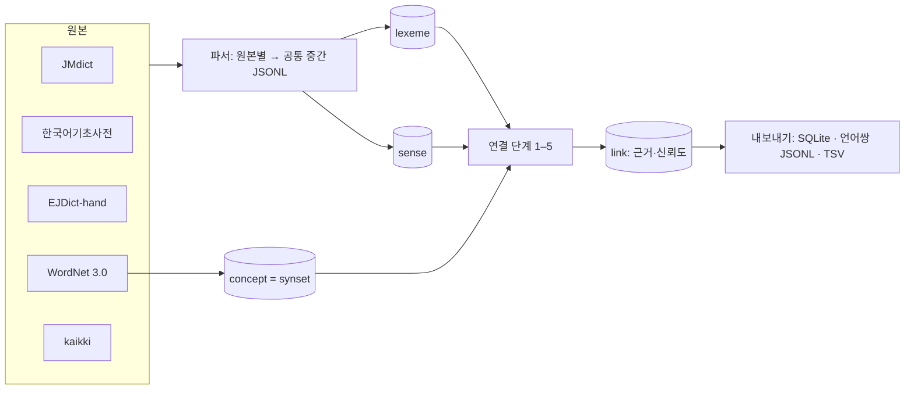

# anikan-ENJPKR-dictionary 계획서

한국어·일본어·영어를 서로 잇는 오픈 사전 데이터를 만든다. 원본은 공개 라이선스 사전 다섯 가지이고, 결과는 **뜻(sense) 단위로 세 언어를 연결한 데이터**(SQLite + JSONL)와, 각 연결이 어디서 왔는지 보여 주는 근거·신뢰도다.

- 작성: 2026-10-29
- 상태: 계획 (아래 「결정이 필요한 항목」을 정하면 0단계부터 시작)

## 1. 목표와 범위

| 언어쌍 | 지금 오픈 데이터의 사정 | 이 리포가 만드는 것 |
|---|---|---|
| 일본어 → 영어 | JMdict가 표준 | JMdict를 그대로 정규화해 포함 |
| 영어 → 일본어 | EJDict-hand(단어 단위), Wiktionary 번역표 | 둘을 합치고 WordNet 뜻 단위로 정리 |
| 한국어 ↔ 영어 | 한국어기초사전 대역어, Wiktionary | 둘을 합침 |
| **한국어 ↔ 일본어** | **큰 오픈 사전이 사실상 없음** | 한국어기초사전 일본어 대역어 + Wiktionary 삼각 연결 + 한자 일치 + 영어 경유 |

핵심 가치는 마지막 줄이다. 한·일 직접 사전이 없으니, 여러 근거를 모아 **어느 근거로 연결했는지와 신뢰도**를 함께 내보낸다.

**하지 않는 것**: 새 뜻풀이를 사람이 쓰는 일, 예문 말뭉치(Tatoeba 등은 후속 확장 후보), 음성·그림.

## 2. 원본 다섯 가지 (2026-10-29 확인)

| 원본 | 형식 | 언어 | 단위·주요 필드 | 라이선스 | 받는 법 |
|---|---|---|---|---|---|
| [JMdict](https://www.edrdg.org/jmdict/j_jmdict.html) (EDRDG) | XML(DTD 포함), 일일 갱신 | 일 → 영(+독·네·러·스·헝·스웨·프·슬로) | `entry/ent_seq` → `k_ele/keb`(한자 표기, `ke_pri` 빈도) · `r_ele/reb`(읽기) · `sense`(`pos`·`xref`·`misc`·`gloss xml:lang`) | CC BY-SA 4.0 + EDRDG 표기 조건 | `https://www.edrdg.org/pub/Nihongo/JMdict.gz` (영어 외 언어 뜻은 별도 sense로 붙음, **한국어 없음**) |
| 한국어기초사전 (국립국어원) | JSON(LMF), 「사전 전체 내려받기」 zip(84 MB, 풀면 1 GB, JSON 11개) | 한 → 한 + **11개 언어 대역(영어·일본어 포함)** | `LexicalResource.Lexicon.LexicalEntry[]` → `feat`(`lexicalUnit`, `homonym_number`, `partOfSpeech`, `vocabularyLevel`, `semanticCategory`, **`origin` = 원어·한자**) · `Lemma`(`writtenForm`, 이표기) · `WordForm`(발음) · `RelatedForm`(파생어 등) · `Sense[]`(`definition`, `Equivalent[]` = `language`·`lemma`·`definition`, `SenseExample`, `SenseRelation`). §2.1 | CC BY-SA 2.0 KR | 로그인 없이 받음: 내려받기 창(`/download/downloadPopup`)의 JSON 버튼 → `https://krdict.korean.go.kr/dicBatchDownload?seq=220`(2026-10-19판, seq는 판마다 바뀌므로 창에서 읽음) |
| [EJDict-hand](https://github.com/kujirahand/EJDict) | TSV(`src/a.txt`…`z.txt`) + `frequency/` | 영 → 일 | 한 줄 = `표제어(쉼표로 이표기) ⇥ 뜻(" / "로 구분)`. 뜻 안에 `〈C〉` `《米》` `『』` 같은 표시. 품사·ID 없음 | **CC0** | git(커밋 고정) |
| [Princeton WordNet 3.0](https://wordnet.princeton.edu/) | `WNdb-3.0` 텍스트 DB | 영 | `data.{noun,verb,adj,adv}` 한 줄 = synset(`오프셋 · 품사 · 단어들 · 관계 포인터 \| 풀이`), `index.*` = 표제어 → synset 오프셋(빈도순) | WordNet License(무료·수정·배포 허용, 저작권·면책 고지를 모든 사본에 포함) | `https://wordnetcode.princeton.edu/3.0/WNdb-3.0.tar.gz` (10 MB). 압축 파일에 라이선스 원문이 없어 웹 원문을 따로 넣음 |
| [kaikki.org](https://kaikki.org) (wiktextract, 영어 Wiktionary) | JSONL | 언어별 표제어 + 영어 풀이, **영어 표제어의 번역표** | `word`·`pos`·`forms`(일본어: 루비·로마자, 한국어: **`hanja` 태그 표기**)·`senses[].glosses`·`etymology_text`·`sounds`. 번역표 `translations[]` = `{sense(영어 뜻 설명), code, word, roman, alt(한국어 한자)}` | Wiktionary: CC BY-SA 4.0 (+GFDL 이중) | 일본어 388 MB · 한국어 208 MB · **영어 3.4 GB**(번역표 용, 2026-10-25판). 영어는 받으면서 `ja`·`ko` 번역이 있는 줄만 거름 |

### 2.1 한국어기초사전 전체 분석 (2026-10-19판을 받아 전부 셈)

| 항목 | 값 |
|---|---|
| 표제어 | 56,555개 — 단어 51,555 · 관용구 2,227 · 구 1,120 · 문법·표현 996 · 속담 657 |
| 뜻(Sense) | 76,833개 |
| 대역어 | 11개 언어(중·영·일·불·아랍·베트남·스페인·몽골·타이·러시아·인니), **일본어 대역이 있는 뜻 75,144개, 영어 75,145개(97.8 %)**. 대역어마다 그 언어의 뜻풀이(`definition`)도 있음 |
| 일본어 대역어 형식 | `かかくひょう【価格表】` = **읽기【한자 표기】** → JMdict의 reb·keb로 바로 찾을 수 있음 |
| 원어(`origin`) | 36,151개 표제어, 그중 한자가 들어간 것 34,147개(예: 학교 → 學校) |
| 뜻 관계(`SenseRelation`) | 유의어 14,374 · 참고어 10,445 · **반대말 2,802** · 작은말 1,286 · 큰말 1,211 · 여린말 695 · 준말 669 · 본말 639 · 센말 560 · 높임말 93 · 낮춤말 17. 각각 대상 표제어 `id`·`lemma`·`homonymNumber` |
| 표제어 관계(`RelatedForm`) | 파생어 13,166 · ☞(가 보라) 9,889 |

## 3. 통합 데이터 모델

원본마다 단위가 다르다(JMdict = 표제어 + 뜻, EJDict = 단어 줄, WordNet = 개념, kaikki = 품사별 표제어). 그래서 **표제어(lexeme) – 뜻(sense) – 연결(link)** 세 층으로 모으고, 영어 쪽 개념은 **WordNet synset**을 축으로 쓴다.



### 3.1 테이블 (SQLite 기준)

```sql
-- 표제어: 언어별 한 형태
CREATE TABLE lexeme (
  id          TEXT PRIMARY KEY,   -- 'ja:jmdict:1206730', 'ko:krdict:12345', 'en:wn:dog' …
  lang        TEXT NOT NULL,      -- 'en' | 'ja' | 'ko'
  lemma       TEXT NOT NULL,      -- 대표 표기(NFC)
  reading     TEXT,               -- 일본어 가나 읽기
  hanzi       TEXT,               -- 한자 표기: 일본어 keb / 한국어 원어(origin)·kaikki hanja
  hanzi_norm  TEXT,               -- 신자체·번체를 맞춘 비교용 한자 열쇠
  pos         TEXT,               -- 공통 품사(§3.3)
  pos_src     TEXT,               -- 원본 품사 그대로
  freq        INTEGER,            -- 원본 빈도 정보(JMdict pri, 기초사전 등급, EJDict frequency)
  source      TEXT NOT NULL,      -- 'jmdict' | 'krdict' | 'ejdict' | 'wordnet' | 'kaikki'
  source_id   TEXT NOT NULL
);

-- 뜻: 표제어의 뜻 하나 + 그 뜻의 풀이(여러 언어)
CREATE TABLE sense (
  id          TEXT PRIMARY KEY,   -- lexeme id + '#' + 순번
  lexeme_id   TEXT NOT NULL REFERENCES lexeme(id),
  ord         INTEGER,
  def_lang    TEXT,               -- 풀이 언어
  definition  TEXT,               -- 같은 언어 뜻풀이(기초사전 한국어 뜻, WordNet 풀이)
  glosses     TEXT                -- JSON: {"en": ["dog"], "ja": ["犬"]} 원본이 준 대역어·풀이
);

-- 개념: 영어 축(WordNet synset)
CREATE TABLE concept (
  id          TEXT PRIMARY KEY,   -- 'wn30:02084071-n'
  pos         TEXT,
  lemmas      TEXT,               -- JSON 목록
  gloss       TEXT
);

-- 연결: 뜻 ↔ 표제어/뜻 ↔ 개념, 근거마다 한 줄
CREATE TABLE link (
  src         TEXT NOT NULL,      -- sense id
  dst         TEXT NOT NULL,      -- lexeme id | sense id | concept id
  kind        TEXT NOT NULL,      -- 'translation' | 'concept'
  method      TEXT NOT NULL,      -- §4의 방법 이름
  confidence  REAL NOT NULL,      -- 0–1
  evidence    TEXT,               -- 사람이 읽을 근거(어떤 영어 뜻, 어떤 한자)
  sources     TEXT NOT NULL       -- JSON: 이 줄에 쓰인 원본 목록(크레딧 계산용)
);

-- 같은 언어 안의 의미 관계: 반의어·유의어 등(§4.1)
CREATE TABLE relation (
  src         TEXT NOT NULL,      -- sense id (원본이 단어 단위면 lexeme id)
  dst         TEXT NOT NULL,      -- sense id | lexeme id
  type        TEXT NOT NULL,      -- 'antonym' | 'synonym' | 'see_also' | 'honorific' | 'humble' …
  method      TEXT NOT NULL,      -- 'source'(원본에 있음) | 'projected'(다른 언어에서 옮김, §4.1)
  confidence  REAL NOT NULL,
  sources     TEXT NOT NULL
);
```

### 3.2 원본 → 모델 대응

| 원본 | lexeme | sense | 바로 나오는 link |
|---|---|---|---|
| JMdict | `entry` 하나에 `keb`·`reb` 조합마다(대표는 첫 keb+reb) | `sense` (영어 gloss만, 다른 언어 sense는 버리거나 별도 보관) | 일 sense → 영어 gloss 문자열 |
| 한국어기초사전 | `LexicalEntry` (단어·구·관용구·속담·문법 표현) | `Sense` (한국어 `definition`) | 한 sense → 영어·일본어 `Equivalent`(일본어는 `읽기【한자】`를 갈라 JMdict 표제어로) |
| EJDict-hand | 줄의 표제어(이표기 각각) | 줄 하나 = 뜻 하나(" / " 조각은 대역어 목록) | 영 → 일 대역어 |
| WordNet | `index.*`의 표제어 | synset 소속 하나 = 뜻 하나 | 영 sense → concept |
| kaikki | 언어별 파일의 `word`+`pos`(+`etymology_number`) | `senses[]` | 일·한 sense → 영어 gloss / 영어 번역표 → 일·한 단어 |

### 3.3 정규화
- 문자: NFC, 전각·반각 통일. 한국어 표제어의 `^`·`-` 제거(기초사전 표기). EJDict 뜻의 `〈C〉`·`《米》`·`『』`·괄호 보충은 떼어 `note`로.
- 품사: 공통 태그(`noun`, `verb`, `adj`, `adv`, `pron`, `num`, `particle`, `aux`, `interj`, `conj`, `affix`, `phrase`, `name`) + 원본 품사 보존. 대응표는 `mappings/pos.tsv`(JMdict 엔티티 `n`·`v1`·`v5k`·`adj-i`·`adj-na`…, 기초사전 `명사`·`동사`·`형용사`·`부사`…, kaikki `noun`·`verb`…, WordNet `n`·`v`·`a`·`s`·`r`).
- 한자 열쇠(`hanzi_norm`): 일본 신자체 ↔ 번체(한국 한자) 대응(Unicode Unihan 이체자 데이터 + 상용한자 구자체 표). 예: 学校 ↔ 學校 → 같은 열쇠.
- 「대응 어휘 없음」「no equivalent」「対訳語無し」 같은 자리표시는 버린다.

## 4. 연결 방법과 신뢰도

방법마다 `method` 이름을 붙여 결과에서 걸러 쓸 수 있게 한다. 같은 쌍에 근거가 여러 개면 합쳐서 신뢰도를 올린다(독립 근거의 noisy-OR).

| # | method | 무엇을 잇나 | 근거 | 기본 신뢰도 |
|---|---|---|---|---|
| 1 | `krdict_equivalent` | 한 sense → 일·영 단어 | 국립국어원이 뜻마다 단 대역어 | 0.9 |
| 1 | `jmdict_gloss` | 일 sense → 영 단어 | JMdict gloss | 0.9 |
| 1 | `ejdict` | 영 단어 → 일 단어 | EJDict 줄 | 0.8 (단어 단위라 뜻 구분 없음) |
| 2 | `kaikki_translation` | 영 sense → 일·한 단어 | Wiktionary 번역표(뜻 설명 포함) | 0.8 |
| 2 | `kaikki_triangle` | 일 ↔ 한 | **같은 영어 번역표 뜻**에 함께 달린 일·한 단어 | 0.75 |
| 3 | `hanzi_match` | 일 lexeme ↔ 한 lexeme | `hanzi_norm` 일치(學校 = 学校) **그리고** 영어 풀이가 겹침 | 0.85 / 영어가 안 겹치면 0.4로 표시(거짓 친구 의심) |
| 4 | `en_pivot` | 일 sense ↔ 한 sense | 양쪽 영어 대역어가 같은 WordNet synset에 떨어짐(IDF 가중 겹침) | 0.3–0.7 |
| 5 | `wn_concept` | 각 언어 sense → concept | 영어 대역어의 WordNet 표제어 + 품사 + 풀이 유사도 | 0.3–0.9 |

- 방법 3의 함정: 같은 한자어라도 뜻이 다른 말(예: 일본어 「勉強」 = 공부, 한국어 「면강(勉強)」 = 억지로 시킴)은 영어 겹침 검사로 걸러 낮은 신뢰도로 둔다.
- 방법 4·5의 함정: 영어 다의어(bank, run)는 한 단어가 여러 synset에 떨어진다. WordNet 빈도순·품사 일치·풀이 단어 겹침으로 점수를 매기고, 0.5 미만은 기본 내보내기에서 뺀다.
- 일본어 쪽 표기 해소: 기초사전·kaikki의 일본어 대역어는 한자일 수도, 가나일 수도 있으므로 JMdict의 keb·reb로 찾아 표제어 ID에 붙인다. 못 찾으면 `ja:unlinked:` 표제어로 남긴다.

### 4.1 반의어·유의어 등 의미 관계

대역어(다른 언어로의 연결)는 위 `link`, 같은 언어 안의 관계는 `relation`에 둔다. 원본별로 있는 것(2026-10-29 확인, 한국어기초사전은 전체, 나머지는 표본):

| 원본 | 반의어 | 유의어·기타 | 단위 | 표본에서 확인한 양 |
|---|---|---|---|---|
| JMdict | `sense/ant` | `sense/xref`(참조·유의) | 뜻 → 「단어・뜻번호」(예: `インナー・1`) | 앞 6 MB에서 ant 39 · xref 1,347 |
| 한국어기초사전 | `SenseRelation` 「반대말」 | 유의어·참고어·작은말/큰말·준말/본말·높임말/낮춤말, `RelatedForm` 파생어 | 뜻 → 표제어(`id`·`homonymNumber`) | **반대말 2,802 · 유의어 14,374 · 참고어 10,445**(전체, §2.1) |
| WordNet 3.0 | 포인터 `!` | 같은 synset = 유의어, `&`(유사 형용사)·`@`(상위어)… | 단어(lemma) 단위 | 반의어 포인터 7,979개(형용사 4,024 · 명사 2,152 · 동사 1,093 · 부사 710) |
| kaikki | `antonyms` | `synonyms`·`related`·`derived` | 표제어 또는 뜻 단위 | 일본어 앞 870개에서 반의어 55 · 유의어 484, 한국어 앞 1,765개(대부분 한자 표제)에서 반의어 5 |
| EJDict-hand | 없음 | 없음 | — | — |

- **원본에 있는 관계**(`method = 'source'`, 신뢰도 0.9): 대상 단어 문자열을 같은 원본의 표제어·뜻 ID로 풀어 저장한다(JMdict의 「・뜻번호」는 그 뜻으로, 기초사전·kaikki는 표기로 찾고 여럿이면 품사로 고름).
- **다른 언어로 옮기기**(`method = 'projected'`): 한 언어에서 A ↔ B가 반의어이고, 다른 언어의 A′·B′가 각각 A·B의 대역(신뢰도 0.7 이상)이면 A′ ↔ B′를 반의어 후보로 둔다. 신뢰도 = 반의어 신뢰도 × 두 대역 신뢰도의 곱. 예: WordNet `hot ! cold` + 일본어 「暑い ↔ hot」「寒い ↔ cold」 → 「暑い ↔ 寒い」. 원본에 이미 있으면 근거만 더한다.
- 결과물: `pairs/*.jsonl` 각 뜻에 `antonyms`·`synonyms` 목록(같은 언어), `relations/{en,ja,ko}.tsv`(신뢰도 0.7 이상).

## 5. 결과물

| 결과물 | 내용 | 대상 |
|---|---|---|
| `anikan.sqlite` | 위 네 테이블 전체 | 앱·분석 |
| `pairs/{ja-ko,ko-ja,en-ja,ja-en,en-ko,ko-en}.jsonl` | 표제어 + 뜻 + 대역어 목록 + 신뢰도·근거·원본 | 가볍게 쓰기 |
| `pairs/*.tsv` | 신뢰도 0.7 이상만, 한 줄 = 표제어 ⇥ 읽기 ⇥ 대역어들 | 사람이 보기, 단어장 |
| `stats.md` | 원본별 개수, 방법별 연결 수, 언어쌍 덮는 비율 | 품질 추적 |
| `ATTRIBUTION.md` + `LICENSES/` | 원본별 저작권·라이선스 원문 | 라이선스 준수 |

결과 데이터는 커서(수백 MB 예상) git에는 넣지 않고 **GitHub Releases**에 날짜 버전(`2026.11.0`)으로 올린다. 리포에는 코드·대응표·작은 표본만.

## 6. 라이선스

| 원본 | 라이선스 | 조건 |
|---|---|---|
| JMdict | CC BY-SA 4.0 | 출처(EDRDG)·라이선스 표기, 같은 라이선스로 공유 |
| 한국어기초사전 | CC BY-SA 2.0 KR | 출처(국립국어원) 표기, 같은 라이선스(또는 같은 요소의 이후 버전) |
| kaikki / Wiktionary | CC BY-SA 4.0 (+GFDL) | 출처(Wiktionary 기여자, kaikki.org) 표기, 같은 라이선스 |
| EJDict-hand | CC0 | 의무 없음(크레딧에는 적음) |
| WordNet 3.0 | WordNet License | 저작권·면책 고지를 모든 사본에 포함 |

- **결과 데이터: CC BY-SA 4.0.** 동일조건(SA) 원본이 셋이므로 결과도 SA여야 한다. CC BY-SA 2.0 KR은 「같은 라이선스 요소를 가진 이후 버전」으로 바꿔 배포하는 것을 허용하므로 4.0으로 합칠 수 있다고 판단한다(법률 자문 아님, 공개 전 한 번 더 확인).
- **코드: MIT**(데이터와 분리).
- 행마다 `sources`를 남기므로, 일부만 쓰는 사람은 실제로 쓴 원본만 표기하면 된다(예: EJDict + WordNet만 쓰면 SA 의무 없음).

## 7. 리포 구성

```
anikan-ENJPKR-dictionary/
├─ PLAN.md · README.md · ATTRIBUTION.md · LICENSE(MIT, 코드) · LICENSES/(원본 라이선스 원문, 데이터는 CC-BY-SA-4.0)
├─ sources.toml          # 원본 버전·주소·체크섬 고정
├─ raw/                  # 받은 원본(.gitignore)
├─ anikan/               # 파이썬 패키지
│  ├─ fetch/             # 원본별 받기(영어 kaikki는 스트림 필터)
│  ├─ parse/             # 원본별 → 공통 중간 JSONL
│  ├─ normalize/         # 문자·품사·한자 열쇠
│  ├─ link/              # 방법 1–5
│  └─ export/            # SQLite · JSONL · TSV · stats
├─ mappings/             # pos.tsv, kyujitai.tsv(신자체↔번체), 자리표시 목록
├─ qa/                   # 손으로 검수한 정답 쌍(gold), 평가 스크립트
└─ tests/                # 원본별 작은 표본으로 단위 테스트
```

도구: Python 3.12, `lxml`(JMdict XML 스트림), `orjson`, SQLite(표준 라이브러리), 테스트 `pytest`. 영어 kaikki 3.4 GB는 받으면서 한 줄씩 걸러 `ja`·`ko` 번역이 있는 영어 표제어만 남긴다(디스크에 원본 전체를 두지 않음).

## 8. 단계

1. **0단계 — 리포 골격**: 구성·라이선스 파일·`sources.toml`·CI(코드 테스트만, 원본은 받지 않음).
2. **1단계 — 원본별 파서**: 다섯 원본 → 공통 중간 JSONL. 완료 기준: 원본별 개수가 공식 수치와 맞고(예: WordNet 3.0 synset 117,659개), 표본 20개를 사람이 대조.
3. **2단계 — 직접 연결(방법 1·2)**: 기초사전 대역어, JMdict gloss, EJDict, kaikki 번역표·삼각 연결. 완료 기준: 6개 언어쌍 JSONL 첫판, `stats.md`.
4. **3단계 — 한자 일치(방법 3)**: 신자체↔번체 대응표, 거짓 친구 걸러내기. 완료 기준: gold 300쌍에서 정밀도 측정, 0.85 이상 구간 정밀도 95 % 이상 목표.
5. **4단계 — WordNet 축(방법 4·5)**: 각 언어 sense → synset, 영어 경유 한·일. 완료 기준: gold에서 방법별 정밀도·재현율 표.
6. **4.5단계 — 반의어·유의어(§4.1)**: 원본 관계를 ID로 풀고, 대역을 따라 다른 언어로 옮김. 완료 기준: 언어별 반의어 쌍 수, 옮긴 반의어 표본 100쌍 정밀도.
7. **5단계 — 내보내기와 첫 릴리스**: SQLite·JSONL·TSV, `ATTRIBUTION.md`, GitHub Release `2026.11.0`.
8. **이후 확장 후보**: Japanese WordNet(wnja, WordNet 3.0 synset에 직접 연결돼 4·5단계 정밀도를 크게 올림), Open English WordNet(갱신되는 후속판, CC BY 4.0), Tatoeba 예문, Yomitan·Anki용 내보내기.

## 9. 품질 검증
- **gold 세트**: 일↔한 300쌍, 영↔일 100쌍, 영↔한 100쌍을 무작위로 뽑아 사람이 맞음·틀림·애매로 표시(`qa/gold.tsv`). 방법·신뢰도 구간별 정밀도를 `stats.md`에.
- **회귀 테스트**: 원본 표본으로 파서 결과 고정, 대표 단어(学校↔학교, 犬↔개, 勉強↔공부)의 연결 결과 고정.
- **덮는 비율**: 기초사전 초급 어휘 중 일본어 대응이 있는 비율, JMdict 상용어(`ichi1`) 중 한국어 대응이 있는 비율.

## 10. 결정이 필요한 항목

| # | 항목 | 추천 | 다른 선택 |
|---|---|---|---|
| 1 | 결과 데이터 라이선스 | CC BY-SA 4.0 (원본 조건상 사실상 필수) | — |
| 2 | 코드 라이선스 | MIT | Apache-2.0 |
| 3 | 영어 kaikki 3.4 GB 처리 | 받으면서 거르기(번역표만, 수십 MB로 줄어듦) | 영어 번역표는 쓰지 않고 일·한 파일만 |
| 4 | 결과 배포 | GitHub Releases (git에는 코드만) | Hugging Face Datasets 동시 게시 |
| 5 | 한국어기초사전 원본 | 내려받기 창에서 최신 JSON 버튼의 `seq`를 읽어 자동으로 받음(로그인 불필요, 2026-10-29 확인) | 공식 Open API는 대량 수집에 맞지 않아 비추천 |
| 6 | WordNet 판 | 요청대로 Princeton 3.0 (다른 언어 WordNet들이 이 판에 연결됨) | Open English WordNet 2024 |
| 7 | 이름 표기 | 리포 `anikan-ENJPKR-dictionary`, 데이터셋 이름 「anikan」 | — |
